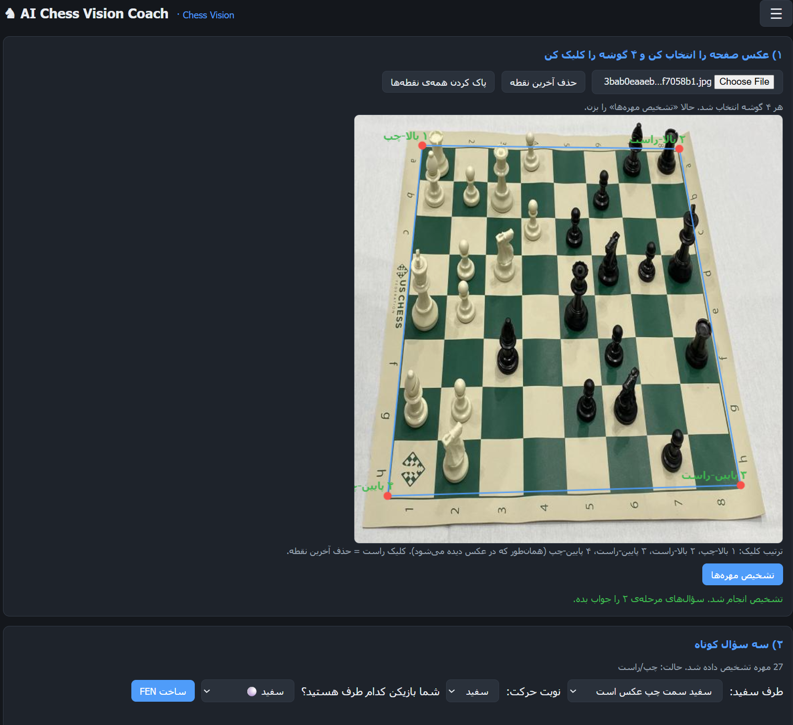
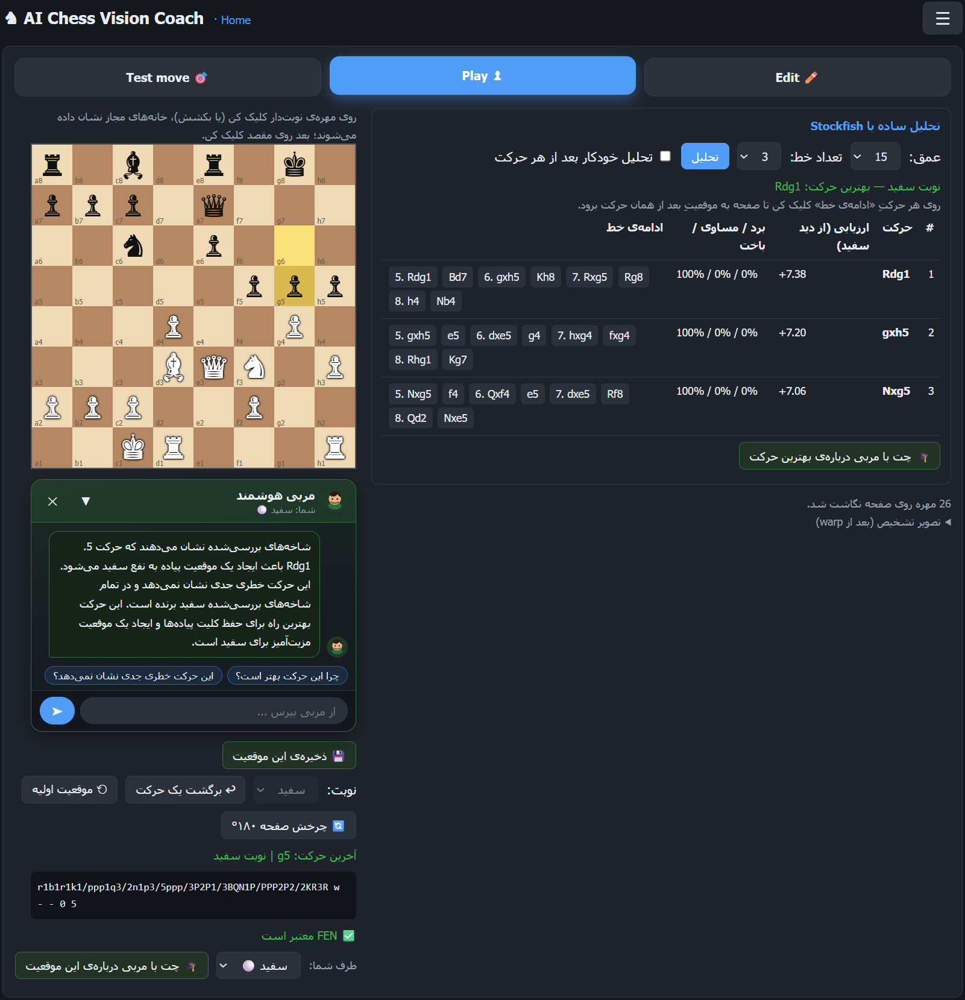
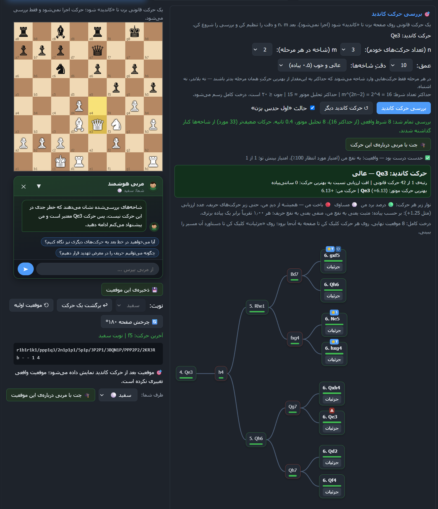
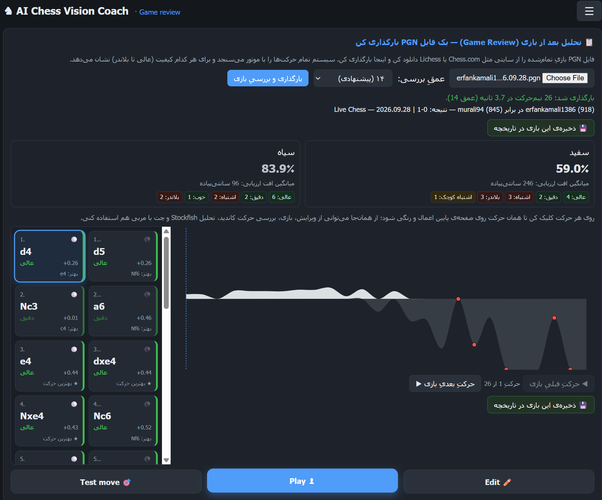
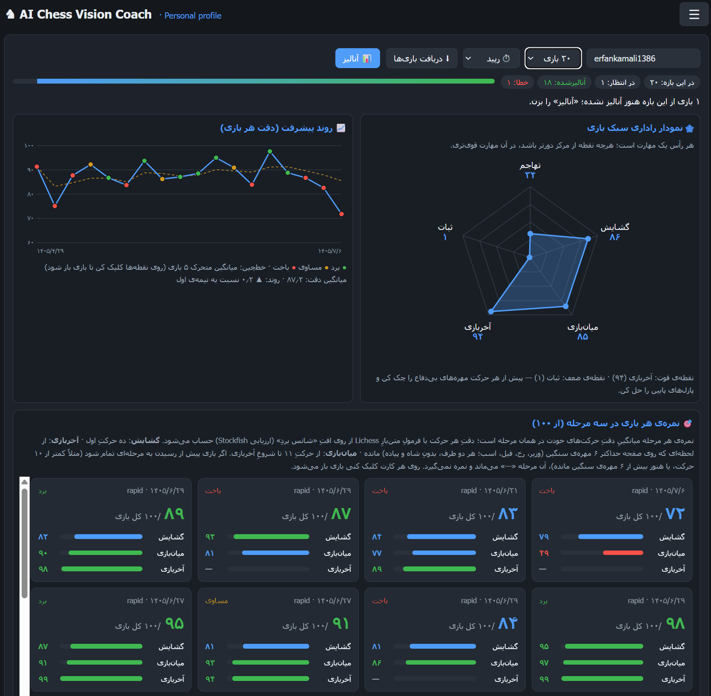

<div dir="rtl">

<h1 align="center">♞ AI Chess Vision Coach</h1>

<p align="center"><b>مربی هوشمند شطرنج با بینایی ماشین</b><br>
از عکسِ صفحه‌ی واقعی تا تحلیل موتور، مربی هوش مصنوعی و تمرینِ شخصی‌سازی‌شده</p>

<p align="center">
  
  
  
  
  
</p>

---

## ✨ این پروژه چیست؟

**AI Chess Vision Coach** سه دنیا را به هم وصل می‌کند:

- 👁 **بینایی ماشین:** صفحه‌ی شطرنجِ واقعی را از روی عکس می‌بیند و به FEN تبدیل می‌کند.
- ⚙️ **موتور Stockfish:** حرکت‌ها را دقیق می‌سنجد.
- 🎓 **مدل زبانیِ محلی:** نتیجه را به فارسیِ ساده و مثل یک مربی توضیح می‌دهد.

بیشتر ابزارها فقط می‌گویند «این حرکت اشتباه بود». این پروژه می‌گوید **چرا** اشتباه بود، **در کدام مرحله** بیشتر اشتباه می‌کنی و **امروز چه تمرینی** لازم داری.

## 🚀 قابلیت‌ها

| قابلیت | توضیح |
|---|---|
| 📷 **تشخیص صفحه از عکس** | ۴ گوشه را کلیک کن؛ YOLO مهره‌ها را پیدا و FEN معتبر می‌سازد |
| ♟ **صفحه‌ی ۲بعدی تعاملی** | ویرایش، بازی با قوانین کامل، Drag & Drop، انیمیشن، چرخش صفحه |
| 📊 **تحلیل Stockfish** | چند خط برتر، درصد برد/مساوی/باخت، پیش‌نمایش ادامه‌ی خط |
| 🎯 **بررسی حرکت کاندید** | درخت «اگر این حرکت را بزنم چه می‌شود؟» با خط محتاطانه و بدترین حالت |
| 🎓 **مربی هوشمند (چت)** | مربی فارسی که فقط با واقعیت‌های راستی‌آزمایی‌شده حرف می‌زند |
| 📋 **تحلیل بعد از بازی** | آپلود PGN، برچسب کیفیت هر حرکت، نمودار ارزیابی |
| 👤 **پروفایل Chess.com** | دریافت بازی‌ها، رادار سبک، روند پیشرفت، نمره‌ی گشایش/میان‌بازی/آخربازی |
| 🧩 **پازل از بلاندرهای خودت** | همان موقعیت‌هایی که اشتباه کرده‌ای را دوباره حل کن |
| 🗓 **تمرین امروز** | برنامه‌ی روزانه‌ی شخصی با مرور فاصله‌دار (۱، ۳ و ۷ روز) |
| 📚 **ذخیره‌شده‌ها** | تاریخچه‌ی بازی‌ها و موقعیت‌ها |
| 🌐 **دو زبانه** | رابط فارسی (راست‌به‌چپ) و انگلیسی |

### 📸 تصاویر محیط برنامه

#### 📷 تشخیص صفحه از روی عکس
۴ گوشه‌ی صفحه را روی عکس کلیک کن تا مهره‌ها تشخیص داده شوند و FEN ساخته شود.

<p align="center"></p>

#### 📊 تحلیل Stockfish و چت با مربی
خطوط برتر موتور با ارزیابی و درصد برد/مساوی/باخت، و گفتگو با مربی درباره‌ی بهترین حرکت.

<p align="center"></p>

#### 🎯 بررسی حرکت کاندید
درخت شاخه‌های «اگر این حرکت را بزنم چه می‌شود؟» همراه با برچسب کیفیت حرکت و توضیح مربی.

<p align="center"></p>

#### 📋 تحلیل بعد از بازی (Game Review)
دقت هر دو طرف، کارت رنگیِ هر حرکت و نمودار ارزیابیِ کل بازی، با بارگذاری یک فایل PGN.

<p align="center"></p>

#### 👤 پروفایل شخصی Chess.com
نمودار راداری سبک بازی، روند پیشرفت و نمره‌ی هر بازی در سه مرحله‌ی گشایش، میان‌بازی و آخربازی.

<p align="center"></p>

### چرا مربی «توهم» نمی‌زند؟
همه‌ی واقعیت‌ها (جای مهره‌ها، مهره‌های بی‌دفاع، تهدید مات، نتیجه‌ی شاخه‌ها) را **پایتون و Stockfish** حساب می‌کنند و مدل زبانی فقط آن‌ها را شرح می‌دهد.

### تمرین شخصی‌سازی‌شده
از روی ضعیف‌ترین محورِ رادارِ تو (گشایش، میان‌بازی، آخربازی، ثبات، تهاجم) هر روز ۶ تمرین ساخته می‌شود؛ تمرینی که درست حل کنی ۱، ۳ و ۷ روز بعد برمی‌گردد و بعد از آن «تسلط‌یافته» حساب می‌شود.

## 🧱 معماری

```
┌──────────────────────────────────────────────────────────┐
│  رابط کاربری  ·  app/static/demo.html (JavaScript خالص)   │
└───────────────────────────┬──────────────────────────────┘
                            │ REST (JSON)
┌───────────────────────────▼──────────────────────────────┐
│  لایه‌ی API  ·  app/main.py  +  app/schemas.py (Pydantic)  │
└───────────────────────────┬──────────────────────────────┘
                            │
┌───────────────────────────▼──────────────────────────────┐
│  لایه‌ی سرویس‌ها  ·  app/services/                          │
│  game · explore · review · coach · profile · training     │
│  storage · chesscom_client · vision · engine              │
└───┬────────────┬─────────────┬─────────────┬─────────────┘
    │            │             │             │
 Stockfish     YOLO+OpenCV    Ollama       SQLite + Chess.com API
  (UCI)        (best.pt)    (Qwen2.5)
```

## 📦 مراحل

```bash
# 1) کلون و ساخت محیط مجازی
git clone https://github.com/<username>/<repo>.git
cd <repo>
python -m venv .venv
source .venv/bin/activate        # در ویندوز: .venv\Scripts\activate

# 2) نصب وابستگی‌ها
pip install fastapi "uvicorn[standard]" python-multipart pydantic \
            python-chess ultralytics opencv-python numpy requests ollama

# 3) مدل زبانی
ollama pull qwen2.5:7b-instruct

# 4) اجرا
uvicorn app.main:app --reload
```

سپس در مرورگر باز کن: **http://127.0.0.1:8000/demo**

> اگر Stockfish یا `best.pt` در مسیر دیگری است، مقدار `STOCKFISH_PATH` و `MODEL_PATH` را در `app/config.py` تغییر بده.
> اگر از Linux/macOS استفاده می‌کنی، به‌جای `stockfish.exe` فایل اجرایی مخصوص سیستمت را بگذار.

## ⚙️ تنظیمات مهم (`app/config.py`)

| تنظیم | معنی |
|---|---|
| `ENGINE_THREADS`, `ENGINE_HASH_MB` | منابع Stockfish |
| `EXPLORE_MAX_ANALYSES`, `EXPLORE_MAX_SECONDS` | سقف تحلیل و زمان در «حرکت کاندید» |
| `REVIEW_DEFAULT_DEPTH`, `REVIEW_MAX_PLIES` | عمق و حداکثر طول بازی در Game Review |
| `OLLAMA_MODEL` | مدل زبانیِ مربی |
| `TRAIN_PLAN_SIZE`, `TRAIN_REVIEW_INTERVALS` | اندازه‌ی برنامه‌ی روزانه و فاصله‌های مرور |
| `MAX_SAVED_GAMES`, `MAX_SAVED_POSITIONS` | سقف ذخیره‌شده‌ها |

## 🔌 مسیرهای اصلی API

| گروه | مسیرها |
|---|---|
| سلامت و رابط | `GET /health` · `GET /demo` |
| بینایی | `POST /recognize` |
| موقعیت و بازی | `POST /position` · `POST /move` · `POST /analyze-fen` |
| کاوش | `POST /explore` |
| مربی | `POST /coach` · `POST /coach/chat/start` · `POST /coach/chat` |
| بازبینی بازی | `POST /game/load` |
| پروفایل | `POST /profile/import` · `POST /profile/review/start` · `GET /profile/{u}/status` · `/style` · `/games` |
| تمرین | `GET /profile/{u}/training/today` · `POST /training/answer` |
| ذخیره‌شده‌ها | `/saved/games` · `/saved/positions` |

مستندات تعاملی FastAPI: **http://127.0.0.1:8000/docs**

## 🧭 مسیر توسعه

- صف کار (Celery/RQ) و چند نمونه موتور برای کاربران هم‌زمان
- احراز هویت واقعی و محدود کردن CORS
- یکسان‌سازی فرمول دقت در Game Review و پروفایل (فرمول Lichess)
- تشخیص خودکار گوشه‌های صفحه و ویدیوی زنده
- پشتیبانی از Lichess در کنار Chess.com
- بسته‌بندی با Docker و نسخه‌ی موبایل

## 🙏 قدردانی

[Stockfish](https://stockfishchess.org/) · [python-chess](https://python-chess.readthedocs.io/) · [Ultralytics YOLO](https://github.com/ultralytics/ultralytics) · [Ollama](https://ollama.com/) · [Chess.com Published-Data API](https://www.chess.com/news/view/published-data-api) · فرمول دقتِ متن‌بازِ [Lichess](https://lichess.org/)

</div>
